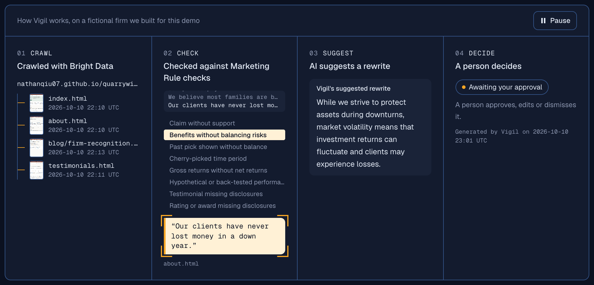
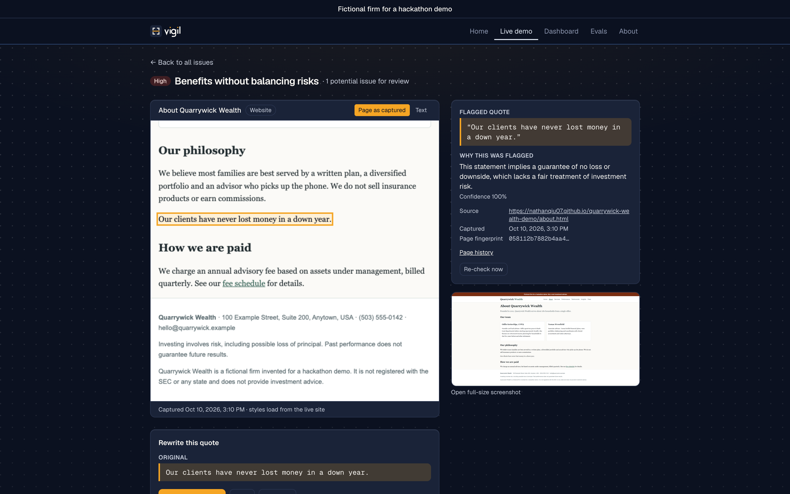
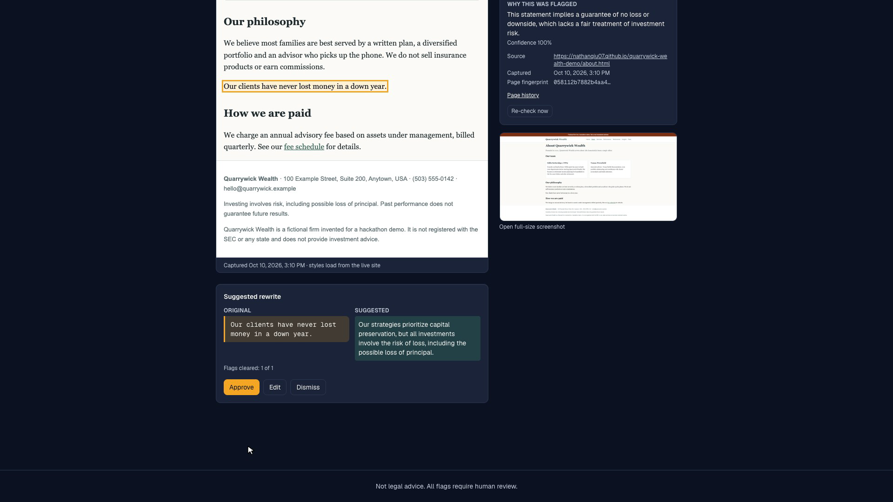

# Vigil

**Vigil scans what your firm has published online and flags anything that may conflict with your compliance policy, with the exact quote, for a human to review.**

### ▶ Try it live: **[marketing-rule-watch-a0747dd2.base44.app](https://marketing-rule-watch-a0747dd2.base44.app/)**

| | |
|---|---|
| **Live app** | https://marketing-rule-watch-a0747dd2.base44.app/ |
| **Findings, no sign-in** | https://marketing-rule-watch-a0747dd2.base44.app/demo |
| **Demo firm site (fictional)** | https://nathanqiu07.github.io/quarrywick-wealth-demo/ |
| **Third-party review site (fictional, built by Devin)** | https://nathanqiu07.github.io/advisorquill/ |
| **Code** | https://github.com/jadenvv/talktousers-Group3 |
| **Pitch deck** | [`Vigil Pitch.pdf`](Vigil%20Pitch.pdf) |
| **Silent demo clips** | [`marketing-rule-watch/research/screenshots/clips/`](marketing-rule-watch/research/screenshots/clips/) |

Built at the Talk to Users hackathon (SF Tech Week, 10 Oct 2026) for **compliance officers at small SEC-registered investment advisers**. The policy it checks against today is the SEC Marketing Rule (Rule 206(4)-1).

> Not legal advice. All flags require human review. Vigil says "potential issue for review", never "violation".



The demo firm, **Quarrywick Wealth**, is fictional. Its site was built for this demo with 11 planted issues and an answer key (`marketing-rule-watch/demo-site/ANSWER_KEY.md`). Vigil makes no claims about any real firm.

## Try it in a minute

1. Open the [live app](https://marketing-rule-watch-a0747dd2.base44.app/) and type `nathanqiu07.github.io/quarrywick-wealth-demo` into the Scan box.
2. Vigil finds the firm's pages. Click **Open results**.
3. Open any flag to see the exact quote highlighted on the page as captured, why it was flagged, the capture time and the page fingerprint.
4. Click **Suggest a rewrite**, then approve, edit or dismiss it.

No sign-in needed. To skip the scan, go straight to [`/demo`](https://marketing-rule-watch-a0747dd2.base44.app/demo).

| Every flag shows its evidence | A person approves the rewrite |
|---|---|
|  |  |

## Demo flow

1. **Home** (`/`): what Vigil does, with a before/after of a real flag.
2. Type the demo firm's URL. **Setup** (`/setup?site=…`) runs live discovery of the firm's pages.
3. **Open results** goes to the existing scan, so no fresh crawl is needed.
4. **Inbox**: every potential issue found on the firm's pages.
5. **Flag detail**: the exact quote highlighted in the page text, a screenshot, the page as captured, a re-check that fetches the live page again, and the page's history of dated captures.
6. **Rewrite**: a suggested rewrite, drafted only when the reviewer asks for one.
7. **Approve, edit or dismiss.** Each choice is saved as a Decision in an append-only audit log.
8. **"Before your exam"** print view.

## How it works

The core loop is **crawl → flag → rewrite → approve**. The product runs entirely inside Base44; laptops were only used to develop the detector, run the eval and test the crawl.

```
 Fictional firm site (static, planted issues)
        │  public URL
        ▼
 Base44 fn `discover` ──► Base44 fn `scan` ──► Page rows ──► Base44 fn `detect` ──► Flag rows
 (site links, sitemap;     (Bright Data Web                   (LLM detector +         │
  Bright Data SERP,         Unlocker: markdown,                grounding filter:       ▼
  admin only)               screenshot, raw HTML)              quote must appear  Base44 React app:
                                                               word-for-word)     inbox · flag detail ·
                                                                                  rewrite · decisions
```

- **Base44**: hosting, the React app, five entities (Firm, Page, Flag, Decision, Recheck) with row-level security, nine backend functions, Google sign-in, file storage. The LLM is Base44's built-in **InvokeLLM**.
- **Bright Data**: every page Vigil reads comes through the Web Unlocker: markdown text, screenshots and raw HTML. The SERP API finds pages about the firm elsewhere on the web (admin-only, off in the demo). Each scan reads at most 25 URLs and never retries.
- **Daytona**: an admin-only **Check calculation** tool on the flag detail screen. A reviewer types the numbers behind a stated return (for example $10,000 → $15,000 "a 60% return"). One fixed Python script recomputes it in a fresh Daytona sandbox, which is then deleted. It checks arithmetic only; it does not verify that the performance was real.
- **Devin (Cognition)**: built **AdvisorQuill** (https://nathanqiu07.github.io/advisorquill/), a fictional third-party review site with 4 planted issues on the demo firm's profile, from our brief (PR #4, Devin-authored commits). Vigil catches all 4 live (see results). Who built the firm site itself is not yet verified.

Full detail, with file paths and live counts: `marketing-rule-watch/research/sponsor_usage.md`.

## Measured results

Every number below comes from **one run**; the LLM isn't fully deterministic. Unless a section names another model, it is detector v3 on Base44 InvokeLLM (10 Oct, 16:03–16:05), the live app. These are the numbers in the pitch deck. Source: `marketing-rule-watch/research/slide_numbers.md`; reports are in `marketing-rule-watch/eval/reports/`.

**Synthetic test set** (37 cases we wrote from SEC deficiency categories: 19 with planted issues, 18 clean):

| Metric | Keyword baseline | Live LLM detector |
|---|---|---|
| F1 | 0.70 | 0.98 |
| Precision | 0.68 (15 of 22) | 0.95 (21 of 22) |
| Recall | 0.71 (15 of 21) | 1.00 (21 of 21) |
| Clean docs wrongly flagged | 28% (5 of 18) | 0% (0 of 18) |
| Flag quote found word-for-word in the text | 100% | 100% |

*No compliance professional has reviewed these cases, and the prompt was developed with them visible, so this is not a blind test.*

**Tester-style cases** (10 cases we wrote from Sense Check 1 testers' comments): keyword baseline caught 0 of 5 issues and flagged 2 of 5 clean cases; the live detector caught 5 of 5 and flagged 0 of 5. *The testers did not write or label these cases, and 3 of them were written together with the fix they test.*

**Our fictional demo site**: the first in-app scan found 9 of 11 planted issues. We fixed the two misses; it now finds 11 of 11 with 0 false alarms. *One run, on a site we built and tuned the detector on. Not real-world accuracy.*

**Third-party review site (AdvisorQuill, built by Devin)**: the demo firm's AdvisorQuill profile is in the app as a review-site page. The live detector flagged all 4 planted issues under the answer key's categories, and none of the page's clean content. `/demo` shows these 4 flags without sign-in, bringing the demo firm to 11 pages and 15 flags. *One page, one run (about 6:45 PM). The site was written from a brief based on our own issue categories, so this is not an independent test.*

**Consistency**: 3 pages, 2 runs each. 2 of 3 pages gave identical flags; 3 of 3 flagged the same categories. *Too few calls for a rate.*

**Vigil vs a plain one-prompt LLM** (same model, Claude Haiku, run offline): we built the "just ChatGPT with a prompt" version too (one call per page, a bare category list, no examples, grounding or suppression) and ran both over every eval set we have: 125 cases in 8 sets, none dropped.

| | Vigil pipeline | Plain prompt |
|---|---|---|
| Issues caught | 76 of 77 | 75 of 77 |
| Wrong flags | **4** | 111 |
| Clean cases flagged | 3 of 56 | 19 of 56 |
| F1 | **0.97** | 0.57 |

On the 35-case panel: both caught 21 of 21; wrong flags 1 vs 28; clean pages flagged 0 of 15 vs 4 of 15; right rule cited 95% vs 52%. On its 16 tester-feedback cases: 0 vs 10 wrong flags. The same panel on gpt-oss-120b: F1 0.98 vs 0.65. *Run on Claude Haiku, not the live app's InvokeLLM, and the pipeline uses the next detector version (v4), not yet live. Reports: `versus_haiku55_allsets.json`, `versus_haiku55_panel.json`.*

**Cases from real SEC orders**: 24 of our 180 distinct eval cases (13%) are built from 12 SEC settled orders that fined advisers: 13 use the ad wording the SEC quoted, 6 the firm's page as archived by the Wayback Machine, and 5 are our corrected rewrites as clean controls. The other 156 we wrote ourselves. On Claude Haiku, Vigil caught 22 of 30 issues vs the plain prompt's 25, with 19 wrong flags vs 59 and 1 of 5 clean cases flagged vs 3 of 5. *The SEC-order cases are kept out of this repo (`private-eval-data/`) and are not in the 125 above.*

No tester labeled any eval case, so none of these numbers are "tester-validated".

## What we changed because of testers

The changes behind each tester quote, with commits, are in `marketing-rule-watch/research/what_we_changed.md`.

## Known limitations

- **Bright Data markdown drops the end of a page**: one character for each extra UTF-8 byte on the page (·, ®, curly quotes). On the demo pages only the end of the footer disclaimer is lost; the raw HTML captures are complete.
- **Discovery**: anyone can discover the demo firm's own site; signed-in users can discover any site's own pages (guarded against SSRF). Web search is admin-only and off in the demo. A DNS-rebinding window between the check and the fetch remains.
- **Re-check cap is soft**: simultaneous scripted calls can each spend a credit.
- **Rule paragraph references are hidden** in the UI until a mentor or compliance professional confirms them.

## Repo map

All project code is in `marketing-rule-watch/`.

| Folder | What |
|---|---|
| `research/` | Sense Checks, tester feedback log, what we changed, slide numbers, submission |
| `base44/` | The Base44 app: screens, entities, backend functions, demo mode |
| `crawl/` | Bright Data crawl and discovery, ported into Base44 |
| `engine/` | Detection and rewrite prompts, grounding filter |
| `eval/` | Eval harness, cases, reports |
| `demo-site/` | The fictional firm site with planted issues, plus its answer key |
| `brand/` | Vigil logo, palette and tokens |

Project status and owners: `PROJECT.md`. Shared contracts (Page, Flag, Decision, the issue taxonomy): `marketing-rule-watch/CLAUDE.md`.
